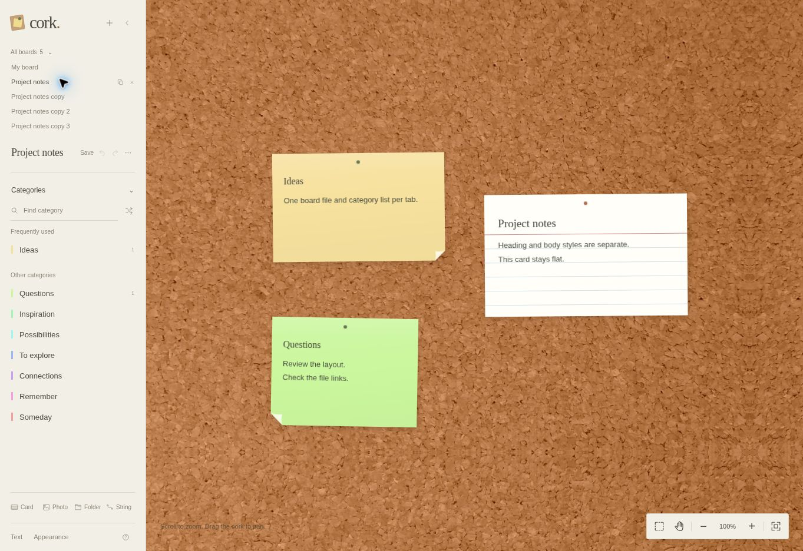
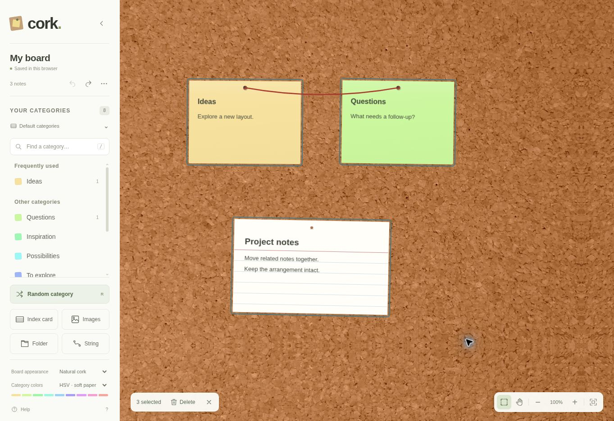
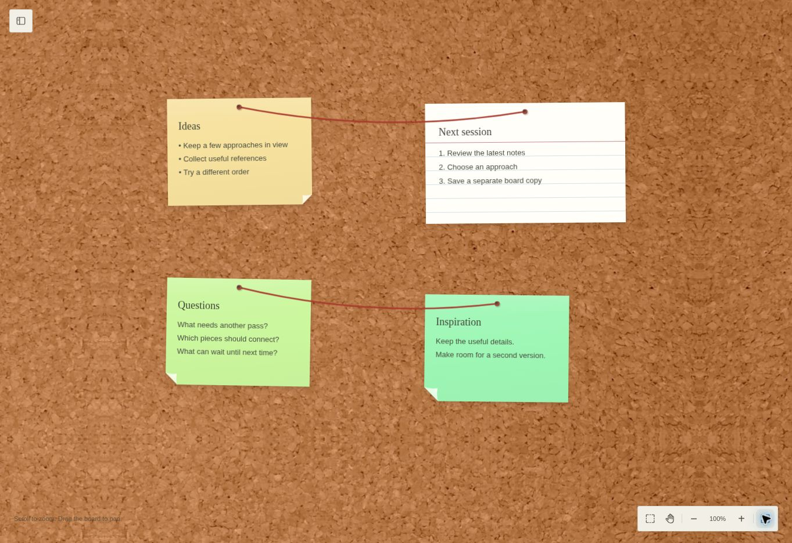
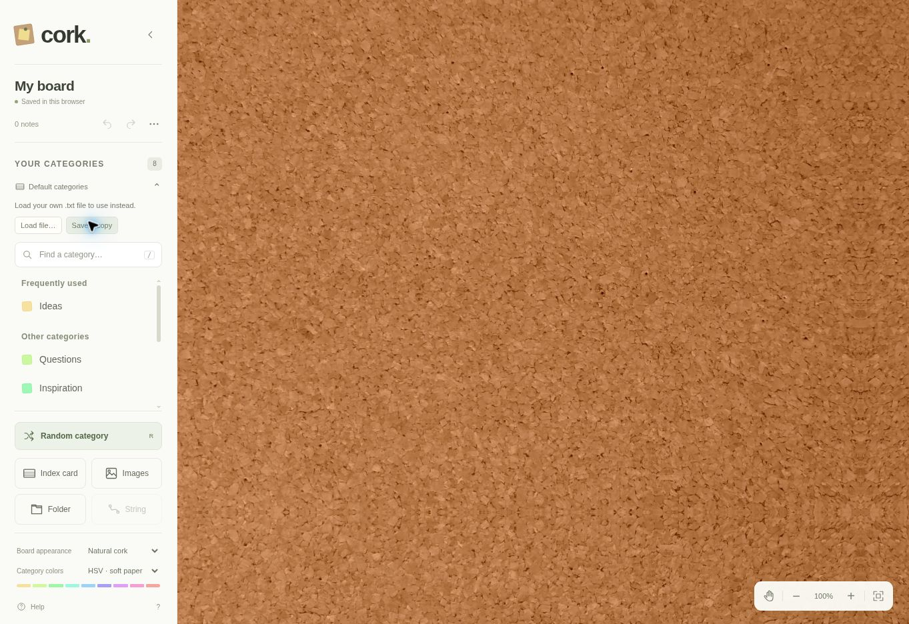

# Cork

A cork board for notes, index cards, Polaroid photos, and local folder links. An empty board shows plain cork.

[Open Cork](https://briday1.github.io/cork/)



**Plain HTML, CSS, and JavaScript. No backend, accounts, API keys, or install step required.** GitHub Pages serves the same static files that run locally.

## Use the board

1. Choose a category in the left sidebar. A preview note, with the category in bold, follows your cursor over the board.
2. Click anywhere on the cork to pin it. On a phone or tablet, open the sidebar with the small button in the top-left corner, choose a category, then tap a spot.
3. Type in the note. It grows vertically as you write, and longer lines can widen it. The text is plain text; the list button adds bullets and Enter continues bulleted or numbered lists. Press Enter on an empty bullet to finish the list.
4. Grab a note by its **top edge** to move it anywhere. You can also focus that edge with Tab and move it with the arrow keys; hold Shift for one-pixel adjustments.

**Index card** places a larger, lined card with its own editable title and no category. Both notes and index cards expand with their content. Drag the bottom grip up or down to make a note or card shorter or taller. Drag the bottom-right corner to resize width and height together. Written content always stays visible. Double-click the bottom grip to restore automatic height, or the corner to restore automatic sizing. With a grip focused, use the arrow keys to resize; hold Shift for one-pixel adjustments.

**Select multiple items:** Shift-click to add or remove notes, cards, photos, folders, or strings from the selection. The **Select tool** beside the hand tool also lets you click to toggle items or drag a box across the cork. Hold Shift while drawing another box to add to the selection. Drag a selected item in Select mode, or its top edge in normal mode, to move the selected papers together; strings follow their pins. Arrow keys on a selected item’s move handle move the whole group. Use **Delete selected elements** (or Delete/Backspace) to remove the selection and any attached strings in one undoable change. **Clear selection** clears the group; Escape also exits Select mode. Hold Space to pan temporarily without losing your selection.



Use **Find a category** to search the scrollable list. The sidebar works with 100 or more categories. **Random category** picks from the entire category file, even when a search is active, and avoids immediately repeating the currently attached category when there is a choice.

**Images**, beside **Index card**, opens an image file picker. Choose a file, then click the board to place a fixed 286 × 348 Polaroid. Write a caption of up to 120 characters underneath; captions use the same larger font as note headings and fit within the footer. Click the photo to open the full original in a new tab. Move the Polaroid by its top edge. The image is cropped to a square inside the frame; the original remains intact. PNG, JPEG, WebP, GIF, and AVIF originals are retained; other browser-readable formats are flattened to PNG.

**Folder** opens a system folder picker. Select a folder, then place its manila folder tile on the board. Its name appears on the tab. Browsers with `showDirectoryPicker` remember the folder and reopen the picker there. Other current browsers use a directory-selection input and ask you to select the folder again when opening a tile; this fallback needs a folder containing at least one file so the browser can supply its name. Some browsers call that selection “Upload,” but Cork uses only the folder name and does not read, store, or upload the files. This opens a folder dialog, not a Finder or Explorer window. Imported folder links may need to be reconnected on another browser or device.

**String** connects two different items. Click String, then the first item and the second. Red yarn joins their thumbtacks and follows them as you move, resize, pan, and zoom. Press Escape to cancel. Select a string and press Delete to remove it, or use Undo. Deleting an item also removes its strings; Undo restores both. Connections save with the board and appear in PDF exports.

Photos and folders keep a visible thumbtack even without a connection.

In the sidebar’s **⋯** menu, **Export PDF** downloads one page cropped closely around all board items, including items outside the current view. It preserves their arrangement and rotation, uses lossless 4× rendering (384 dpi at original size), and leaves out cork, controls, selection outlines, and shadows. The page has no background fill; most PDF viewers display it as white. Paper colors and photo frames remain. Very large individual notes use a lower capture scale to respect browser canvas limits. The PDF is image-based, so text is not selectable.

Drag empty cork to pan. Use the bottom-right controls to zoom, switch to the hand tool, or fit all notes into view. A trackpad or mouse wheel zooms around the cursor without a modifier key. Two-finger pinch also zooms on touch screens. On phones, tapping note text brings it in close for writing and keeps the caret above the keyboard. Tap **Done** to finish, then pinch or use **Fit all notes** to step back. Escape cancels a note before it is placed.

Select a note to reveal bullet, duplicate, and delete controls. Delete can be undone. The left sidebar holds the board name, save status, undo/redo, and the **⋯** board menu for export/import and the guide. Click the board name to rename it. Collapse the sidebar with its chevron to give the board the whole screen; use the small sidebar button to bring it back. Desktop remembers your preference.



### Keyboard shortcuts

Shortcuts do not fire while you type in a text field.

| Key | Action |
| --- | --- |
| `R` | Attach a random category note |
| `I` | Attach an index card |
| `/` | Search categories |
| `V` | Toggle the Select tool |
| `Shift` + click | Add or remove an element from the selection |
| `Ctrl/Cmd+A` | Select every paper item when not editing text |
| `Enter` | Pin an attached note at the preview position |
| `Escape` | Clear selection, exit Select mode, cancel placement, or close a menu |
| Hold `Space` | Temporarily use the hand tool |
| `Delete` / `Backspace` | Delete the selected elements when not editing text |
| `Ctrl/Cmd+Z` | Undo a board change when not editing text |
| `Ctrl/Cmd+Shift+Z` or `Ctrl/Cmd+Y` | Redo a board change |

## Use your own categories

The repository’s **[`categories.txt`](./categories.txt)** is a default list. You do not need to edit or fork the repository to use your own categories, and you keep receiving app updates.

Open **Default categories** (or your current filename) above the sidebar search. Choose **Save a copy** to download a starting list, edit it with a text editor, and choose **Load file…** to select your local `.txt` file. Each nonempty line is a category:

```text
* Ideas
Questions
Characters
Places
Something completely different
```

Prefix a line with `*` (with or without a space) to put that category in **Frequently used** at the top of the list. The marker is hidden from labels and notes. Other categories appear below. Searching filters both groups, and Random category still uses the entire list. Marking a category does not change its color or position in the underlying category order.

The browser remembers a copy of your loaded list across visits. Where the browser supports linking local files, Cork also remembers the file handle and checks for edits on startup and when you return to the tab. If file permission expires, the saved list keeps working; **Refresh** lets you allow access again. In other browsers, **Reload file…** asks you to select the edited file again. You do not need to reload an unchanged list on every visit. **Use default** switches back to the repository list without changing your notes. Your local file is only read, never overwritten or uploaded. Clearing this site’s browser data removes the saved copy and file link.

Keep two files for a portable setup: your **categories `.txt`** (usually changed rarely) and your **board `.json`** from Export board. The board contains the notes and original images; the categories file is separate. When moving to another browser or device, import the board and load your categories once. A selected categories file is limited to 1 MB.

Leading/trailing spaces and empty lines are ignored. Duplicate names are removed without regard to case. `#` is ordinary category text, not a comment marker. Existing notes keep their category names and content even when you remove or rename a category in the file. A small sidebar notice flags categories used on the board but absent from the file. They appear under **Also on this board** and still work for new notes, searching, Random category, saving, and export. Names are compared without regard to case; cards, photos, and folders do not count as missing categories. Removing a category does **not** delete its notes.

No category count is hard-coded. Maintainers can still edit the repository list to change the default for people who have not loaded a local list; it is fetched without caching. App updates and changes to that default never replace someone’s loaded local list.



## Appearance and color maps

The board uses a bundled photograph of real cork. The grain moves and scales with the notes as you pan and zoom, and mirrored photo edges keep the surface continuous. Index cards have white cardstock, a blank heading area, a red header rule, and blue lines that stay aligned as the title grows. Asset source and license are in [assets/README.md](./assets/README.md).

At the bottom of the sidebar, choose **Natural cork**, **Pale cork**, or **Dark cork** and independently choose a category color map:

| Color map | Character |
| --- | --- |
| **HSV · soft paper** (default) | Evenly spaced cyclic hues; softened saturation keeps dark note text legible |
| Pastel spectrum | Gentle gold, peach, pink, lavender, blue, and green |
| Viridis · soft paper | Purple through blue/green to yellow, mixed with ivory paper |
| Cividis · soft paper | Blue through muted gray to yellow, mixed with ivory paper |
| Warm tones | Yellow, apricot, coral, rose |
| Cool tones | Mint, blue, periwinkle, lavender |
| Earth tones | Sand, clay, sage |

Colors are sampled across the category count in file order. HSV excludes the duplicate end hue. Changing the list order or number of categories can change the assigned colors; note content and position are preserved. With a hundred categories, nearby colors can look similar, so every note also has its category name in bold. Appearance choices save and export with the board. Index cards stay ivory and lined.

## Saving and backups

The board automatically saves notes, positions, widths, heights, theme, color map, board name, and view to **localStorage in your current browser on this device**. Original images, photo previews, and local folder handles use IndexedDB so images do not fill the smaller localStorage quota. The save indicator reports browser-storage failures rather than claiming the board was saved.

- Notes are **not** written back into the repository and are **not** shared with other visitors or other devices.
- Clearing site data, private-browsing cleanup, or moving to another browser/origin can remove or separate the saved board.
- Use the sidebar’s **⋯ → Export board** for a JSON backup including original images. **Import board** validates the file and asks before replacing the current board. Import is undoable in the current session. Folder handles are specific to a browser/device and are reconnected with the system picker when necessary.
- If another tab changes the same board, this tab pauses saving to avoid overwriting it. Export this tab’s copy if needed, then reload to use the saved board.
- A damaged stored board is left untouched and automatic saving pauses. Recover the original storage before intentionally clearing the damaged copy.

This is a personal, browser-local board. There is no server-side storage, collaboration, telemetry, or third-party asset loading.

## Publish on GitHub Pages

The included **Test and publish Cork** workflow tests the app, copies only public site files into `dist/`, and deploys those files on pushes to `main`.

**One-time repository setup:** in **Settings → Pages → Build and deployment → Source**, select **GitHub Actions**. The repository owner must enable this setting. Then run the workflow from **Actions → Test and publish Cork → Run workflow**, or push another commit to `main`.

After a successful deployment, GitHub displays the live URL on **Settings → Pages** and the workflow’s `github-pages` deployment. No custom domain is required. A deployment attempted before Pages is enabled can fail at “Configure Pages”; enable the setting and rerun that workflow.

### Other static hosting or local use

Serve this directory with any static web server. For example, with Python:

```sh
python3 -m http.server 8000
```

Open `http://localhost:8000`. Use a web server rather than double-clicking `index.html`: browsers restrict ES modules and text-file fetching on `file://` URLs.

For a public-files-only folder (Node 22+; no install needed):

```sh
npm test
npm run build
python3 -m http.server 8000 --directory dist
```

The `dist/` build copies the public files and stamps their URLs with a content version so browsers load matching scripts, styles, and textures after an update. It adds no runtime dependency. Deploy the root files or `dist/` to any static host.

## Project files

| File | Purpose |
| --- | --- |
| `categories.txt` | One category per line; the only file you need to edit to replace the list |
| `index.html` | Accessible application shell and built-in help |
| `styles.css` | Cork, paper, responsive layouts, and themes |
| `app.js` | Placement, cursor preview, dragging, editing, pan/zoom, saving, export/import |
| `board-core.js` | Category parsing, color maps, coordinate transforms, import validation, list continuation |
| `image-store.js` | Browser-local image originals, thumbnails, folder handles, and image backups |
| `export-pdf.js`, `export-core.js` | High-resolution PDF capture, transparent page, and tight bounds |
| `tests/core.test.mjs` | Tests for category loading rules, 100 HSV colors, positioning math, lists, and backups |
| `.github/workflows/pages.yml` | Automated checks and GitHub Pages publishing |
